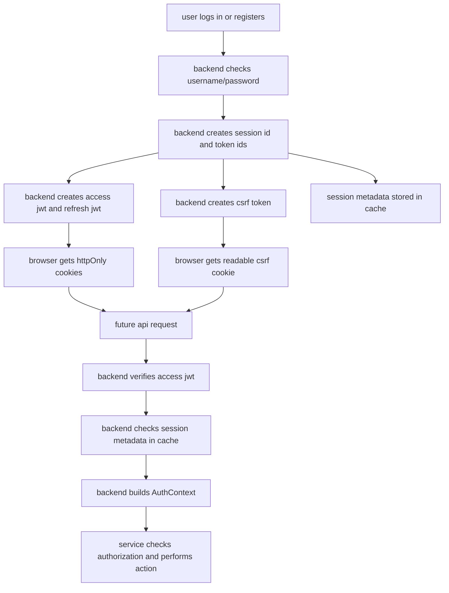

Big Idea::::

So we already know what authentication and authorization mean???

JWT token means: “a signed identity card stored in browser cookies!”

CSRF token means: “a browser-readable safety token used for POST actions so random outside websites cannot silently use the player’s cookies!”

current files and what they will have to do, elts see:: 

CONFIG FILES:::

1. JwtConfig.php
Stores JWT settings: token names, expiry time, algorithm, cookie rules, issuer, audience, secret length.

2. CsrfConfig.php
Stores CSRF cookie/header names and token length rules.

3. JwtClaimName.php
Stores JWT payload field names like iss, aud, sub, sid, jti, exp.

4. JwtHeaders.php
Stores JWT header field names like alg, typ, and value JWT.

CONSTANTS:::

1. AuthTokenTypeValue.php
Separates token purpose: access token for normal APIs, refresh token for getting a new access token.

2. UserTypeValue.php
Separates users into registered and guest.

UTILITY:::

1. PasswordHasher.php
Hashes password during register and verifies password during login. We never store plain password.

2. HashFactory.php
Creates SHA-256 hashes and secure random strings. Useful for session IDs, token IDs, CSRF tokens.

3. JsonSafeEncoder.php
Safely encodes/decodes JSON. JWT signing needs JSON before base64 encoding.

4. Clock.php
Central place for current time. JWT expiry depends on time.

MAIN AUTH FILES:::

1. CsrfTokenService.php
Creates CSRF token, hashes it for storage, verifies frontend header token against stored hash.

2. JwtSigner.php
Creates a JWT. It builds header + payload, signs them using secret key, and returns header.payload.signature.

3. JwtVerifier.php
Checks if JWT is real. It checks token has correct parts, decodes it, verifies signature, and returns claims.

4. JwtTokenService.php
Higher-level JWT service. It creates access/refresh tokens and validates claims like issuer, audience, token type, expiry.

5. AuthContext.php
After a request is authenticated, this object represents the logged-in user for that request: user id, username, guest flag, session id, token id, csrf hash.

CACHE FILES:::

1. CacheServerTtlConfig.php
Keeps TTL values for cache entries like auth session, match state, rate limit, idempotency.

FLOWCHART::::::::

SO HERE'S THE EXAMPLE LOGIN, LETS SEE HWO IT WILL HAPPEN::::

Player enters:

identifier: neetika
password: secret123

Backend will eventually do:

1. find user by username/email
2. verify password with PasswordHasher
3. create session id
4. create csrf token
5. create access token valid for 30 minutes
6. create refresh token valid for 24 hours
7. store session metadata in cache
8. send cookies to browser

Browser receives cookies like:

cw_access_token = access jwt
cw_refresh_token = refresh jwt
cw_csrf_token = csrf token
cw_user_id = for the purpose of frontend convenience only

Important: cw_user_id is not trustable!!!!!! Real identity always comes from JWT!!!!

Example access token use

When frontend calls API::

GET /api/v1/profile

Browser automatically sends:

cw_access_token

Backend verifies:

signature is correct
issuer is courier-war-api
audience is courier-war-client
token type is access
token has not expired
session still exists in cache
Then backend creates:

AuthContext(userId=12, username="neetika", isGuest=false)
Now services can safely say: “this request belongs to user 12! hehe!!”

example POST action with CSRF

For a mutating API like:

POST /api/v1/matches/123/courier/move
Frontend must send:

Cookie: cw_access_token=...
Header: X-CSRF-Token=<value from cw_csrf_token cookie>
Backend checks both:

access token proves who the user is
csrf header proves this request came from our frontend logic